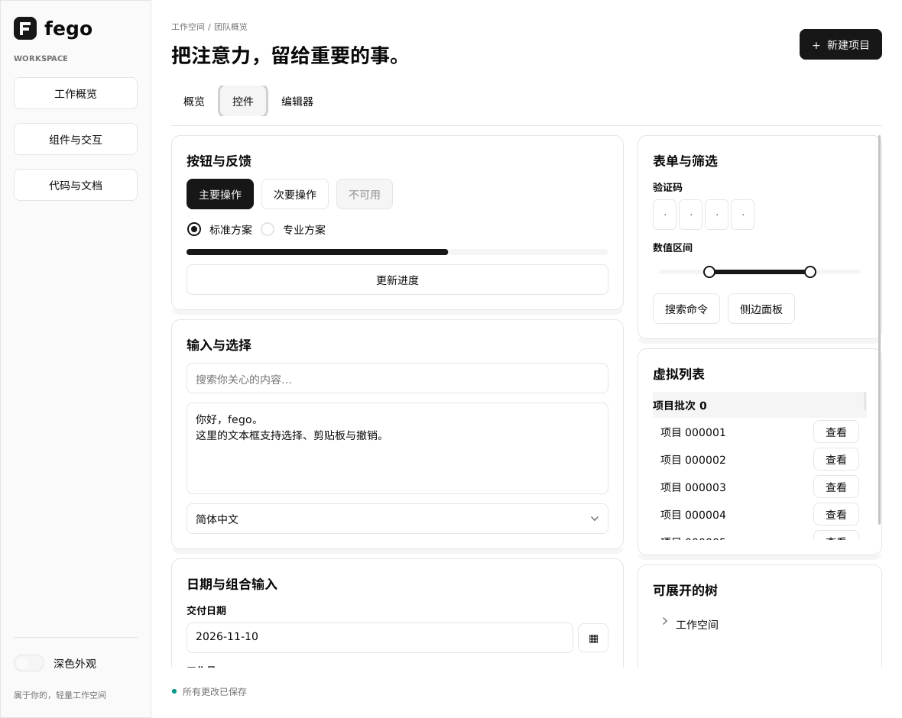

# fego

A lightweight, pure-Go native desktop UI toolkit for Linux, Windows, and macOS — no CGO or WebView required.

Go 编写的桌面原生 UI。控件、保留式布局、文本栅格化、输入编辑、主题和局部重绘是独立实现；mygo 仅作为功能及使用方式参考。运行时不使用 mygo、WebView、浏览器、GTK 控件或 FLTK。FLTK 只用于性能对照程序。

窗口平台为 Linux X11（Wayland 桌面通过 XWayland）、Windows Win32、macOS Cocoa，支持 amd64/arm64，`CGO_ENABLED=0`。系统窗口及输入法通过 purego/syscall 调用。Go 标准库、purego、x/image、x/text 与 Linux D-Bus 是当前依赖。

模块路径为 `github.com/zatxm/fego`；应用使用 `github.com/zatxm/fego` 和 `github.com/zatxm/fego/ui` 导入。

## 首版状态

`v0.1.0` 首版准备中，采用 [MIT 许可证](LICENSE)。这是独立 API，不提供 mygo 的源码或 import 兼容层。

Linux X11 已进行原生窗口、像素读回与 AT-SPI 测试；Windows/macOS 目前只在本机完成交叉构建，仍需真机验收。GitHub CI 配置已提供，结果以远端实际运行记录为准。

[首版变更](CHANGELOG.md) · [性能验证](benchmarks/README.md)

| 浅色控件 | 深色控件 |
| --- | --- |
|  |  |

## 运行

需要 Go 1.27.3 或更新版本。

```sh
CGO_ENABLED=0 go run ./examples/gallery
CGO_ENABLED=0 go run ./examples/gallery -dark
CGO_ENABLED=0 go run ./examples/gallery -snapshot gallery.png
CGO_ENABLED=0 go test ./...
go test -race ./ui ./internal/text
```

Linux 运行需要 X11 与系统字体；没有系统拉丁字体时使用内嵌 Go 字体。中文使用系统 Noto CJK、微软雅黑、苹方等字体。Linux 推荐安装 Noto Sans 与 Noto Sans CJK。

当前使用 CPU 绘制，保留脏区重绘、虚拟列表和滚动像素复用。应用不创建 EGL/WGL/NSOpenGL 上下文，不再提供 GPU 渲染器及选择开关。之前的 GPU 对照作为历史记录保留在基准文档中。

文本布局缓存限制为 128 项/128 KiB，事件队列清空回调后复用；没有设置进程全局 GC 或内存限制。

列表短文本在滚动和无障碍查询之间复用，每个窗口最多缓存 64 条、每条最多 1024 字节；超长文本正常显示但不缓存。行数据变化后调用 `Refresh` 或 `SetCount` 更新。

## 使用

```go
package main

import (
    "log"
    "strconv"
    "github.com/zatxm/fego"
    "github.com/zatxm/fego/ui"
)

func main() {
    count := 0
    label := ui.Text("0").FontSize(40).Bold()
    button := ui.PrimaryButton("增加", func() {
        count++
        label.SetText(strconv.Itoa(count))
    })
    doc := ui.View(ui.Column(label, button).Center().Padding(24))
    if err := fego.Run(fego.WindowOptions{
        Title: "Hello fego", Width: 400, Height: 300, Content: doc,
    }); err != nil { log.Fatal(err) }
}
```

控件树创建一次，修改状态使用 `SetText`、`SetValue` 等 setter。控件只能属于一个父节点或窗口。事件回调在 UI 线程执行；工作 goroutine 通过 `window.Update(func(){ ... })` 或 `app.Post` 回到 UI 线程，不能直接修改控件。`Run` 在 `main` 调用，`WhenReady` 在运行之前配置，原生窗口从 `WhenReady` 或 UI 回调创建。

布局尺寸是逻辑像素；宿主窗口、原生事件与无障碍几何使用设备像素。`FillWidth` / `FillHeight` 只填满对应轴，`Grow` 按父容器主轴分配剩余空间。`ScrollView` 裁切并滚动内容，键盘聚焦会将相应控件滚入可视区域。`ui.Tester` 使用与原生窗口相同的布局、绘制和输入逻辑。

列表、表格和树的整数像素滚动会复用已绘制区域，只重绘露出的条带。Linux 使用 X11 像素复制减少上传量；其余后端复用软件像素并正常呈现。布局或数据更新、覆盖层、透明背景、非整数位移等情况走完整重绘。行数据变化后仍需调用 `Refresh`、`SetRows` 或相应 setter。

## 已实现的控件和能力

| 类别 | 接口 |
| --- | --- |
| 布局 | Box、Row、Column、Grid、Card、ScrollView、间距、padding、尺寸和对齐 |
| 基础控件 | Text、RichText、Button、PrimaryButton、Checkbox、Radio、Switch、Separator、Image |
| 表单 | TextInput、TextArea、密码、Field、Form、Select、ComboBox、NumberInput、Slider、Progress |
| 导航与反馈 | Tabs、Segmented、Accordion、Breadcrumbs、Menu、Dropdown、Dialog、Toast、Badge、Avatar |
| 数据 | 可见行绘制的 List、Table（列排序）、Tree（展开/折叠）、LineChart、BarChart |
| 日期与文档 | Calendar、DatePicker、带行号的 CodeEditor、Markdown 常用语法 |
| 绘图 | Canvas、Painter 的矩形、圆角、圆、线、文本、图片、Theme、Bounds |
| 输入 | 鼠标、滚轮、Tab/方向键、Unicode、选择、剪贴板、撤销、系统输入法提交文本 |
| 无障碍 | Linux AT-SPI、Windows MSAA、macOS NSAccessibility 的树、状态、动作与基本文本 |

复合控件如 `Tabs`、`DatePicker`、`NumberInput`、`ComboBox` 和图表通过 `.Element` 放入布局；保留原对象调用其专用 setter，通过 `.Element.Width(...)` 等配置布局，避免把 Box 的通用方法误当作复合值更新。它们保留各自状态，程序 setter 不触发用户交互回调。`Badge` 和 `Avatar` 是构造时生成的静态装饰，更新时替换节点。工作空间示例展示中文表单、动态表格、弹窗、页面切换及浅/深主题。

## 实现边界

这是独立设计的 API，不是 mygo 的源码或 import 兼容层。覆盖上述控件功能，不等同于 mygo 所有高级能力：目前没有 GPU 渲染/自定义着色器/3D/视频、富文本所见即所得编辑、LSP、完整 CommonMark、复杂文字 shaping/BiDi、彩色 emoji、原生 Wayland 后端。Markdown 的 HTML 是普通文本，链接只通知应用且只允许 http/https/mailto。文本编辑以 Unicode rune 为选择偏移，尚非完整 Unicode grapheme 编辑器。

输入框的外部粘贴和输入限制为 1,048,576 个 rune；撤销保留最多 64 次且文本总计不超过 4 MiB；字形和文本布局缓存有固定预算。密码字段不支持复制/剪切，辅助功能仅取得掩码。系统字体、图形和原生 API 的平台差异仍需真机验收。

## 验证与性能

可复现的对照程序和测量口径见 [benchmarks/README.md](benchmarks/README.md)。60 Hz 帧率接近只代表满足帧预算，不能代替 CPU/内存的 5% 对照。

Linux GUI 测试在专用 Xvfb 上运行，避免影响桌面；`FEGO_X11_TEST=1` 启用实际原生窗口测试，`FEGO_XCLIP` 指定 xclip 启用跨进程剪贴板测试。`scripts/check-gallery.py` 使用独立 Xvfb 和 D-Bus，验证真实窗口中的保存、弹窗、页面、键盘及截图，需要开发环境的 Python dbus、ffmpeg、xdotool。

Linux AT-SPI 首次导出时需已有活动辅助总线；应用启动后才开启读屏，需要重启应用。控件树和动作始终可查询，变化通知按实际注册的读屏订阅过滤。`FEGO_ATSPI_TEST=1` 启用真实 registry/libatspi 测试（需要 at-spi2-core 与相应系统库），不等同于 Orca 人工朗读验收。

Windows/macOS 的实际桌面冒烟测试通过 `FEGO_NATIVE_SMOKE=1 go test ./internal/platform` 启用。交叉编译只验证构建和 ABI 静态断言，不等于这些系统上的运行验证。
