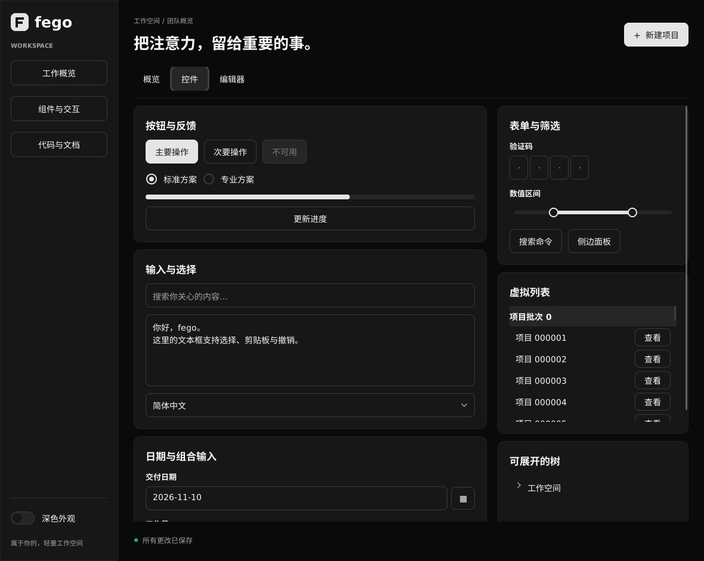

# fego

**English** | [简体中文](README.zh-CN.md)

A lightweight, pure-Go native desktop UI toolkit for Linux, Windows, and macOS — no CGO or WebView required.

fego provides windows, layouts, forms, data views, text editing, and light and dark themes. Create widgets and update their state through Go APIs to build native desktop applications.

[Example](examples/gallery/main.go) · [Performance data](benchmarks/README.md) · [Changelog](CHANGELOG.md) · [CI](https://github.com/zatxm/fego/actions/workflows/ci.yml)

| Light controls | Dark controls |
| --- | --- |
|  |  |

## Supported platforms

| Platform | Window system | Architectures |
| --- | --- | --- |
| Linux | X11; XWayland on Wayland desktops | amd64, arm64 |
| Windows | Win32 | amd64, arm64 |
| macOS | Cocoa | amd64, arm64 |

Linux requires X11 or XWayland at runtime; when `libXext` and a local server provide MIT-SHM, window updates use shared memory and otherwise fall back to regular uploads. CJK text needs system fonts with the appropriate glyphs; Noto Sans CJK is recommended on Linux. Windows and macOS use system fonts. An embedded Go font is used when no suitable system Latin font is available.

## Quick start

Install Go; see [go.mod](go.mod) for toolchain requirements. In an empty directory, create a project and add the dependency:

```sh
go mod init example.com/hello-fego
go get github.com/zatxm/fego
```

Create `main.go`:

```go
package main

import (
	"log"
	"strconv"

	"github.com/zatxm/fego"
	"github.com/zatxm/fego/ui"
)

func main() {
	count := 0
	label := ui.Text("0").FontSize(40).Bold()
	button := ui.PrimaryButton("Increment", func() {
		count++
		label.SetText(strconv.Itoa(count))
	})
	doc := ui.View(ui.Column(label, button).Center().Padding(24))
	if err := fego.Run(fego.WindowOptions{
		Title: "Hello fego", Width: 400, Height: 300, Content: doc,
	}); err != nil {
		log.Fatal(err)
	}
}
```

Run the application or build an executable:

```sh
go run .
go build .
```

## Run the gallery

Clone the repository to explore forms, tables, dialogs, page navigation, and theme switching:

```sh
git clone https://github.com/zatxm/fego.git
cd fego
go run ./examples/gallery
```

Use command-line options to start with a dark theme or save a window screenshot:

```sh
go run ./examples/gallery -dark
go run ./examples/gallery -snapshot gallery.png
```

## System tray and multiple windows

Run `go run ./examples/tray` inside a desktop session with tray support. The example starts in the tray, opens a window from its menu and keeps running after that window closes. Choose **Quit** from the tray to exit.

Set `AppOptions.ID`, `Name` and `Icon` before `Run`. On Linux, match the ID to your desktop entry's `StartupWMClass`. On Windows, use the same AppUserModelID for packaged shortcuts. On macOS, set the bundle identifier in the app's Info.plist. The bundle and installer also provide the icon shown by the file manager.

Use `Window.Show`, `Hide` and `Activate` to control a specific window. Register `Window.OnClose` to intercept a close request. `AppOptions.KeepAlive` allows apps to run with no windows and `app.Quit()` exits the whole app.

Create trays and update their menus on the UI thread. From worker goroutines, use `app.Post`. Linux needs a StatusNotifierItem host on the session bus. `Tray.Available()` reports whether a host is available. Primary click and tooltip presentation depend on the desktop. The macOS menu bar opens an attached native menu on click.

## Widgets and features

| Category | APIs |
| --- | --- |
| Layout | Box, Row, Column, Grid, Card, ScrollView, spacing, padding, sizing, and alignment |
| Basic widgets | Text, RichText, Button, PrimaryButton, Checkbox, Radio, Switch, Separator, Image |
| Forms | TextInput, TextArea, password fields, Field, Form, Select, ComboBox, NumberInput, Slider, Progress |
| Navigation and feedback | Tabs, Segmented, Accordion, Breadcrumbs, Menu, Dropdown, Dialog, Toast, Badge, Avatar |
| Data | List, Table with column sorting, Tree with expand/collapse, LineChart, BarChart |
| Dates and documents | Calendar, DatePicker, CodeEditor with line numbers, common Markdown syntax |
| Drawing | Canvas; Painter rectangles, rounded rectangles, circles, lines, text, and images; Theme, Bounds |
| Input | Mouse, scrolling, Tab and arrow keys, Unicode, selection, clipboard, undo, system input method text commits |
| Accessibility | Linux AT-SPI, Windows MSAA, macOS NSAccessibility |

## Updating state and layout

Create the widget tree once, then update existing widgets with methods such as `SetText`, `SetValue`, and `SetSelected`. Each widget belongs to one parent or window. Calling a setter does not invoke user interaction callbacks.

Event callbacks run on the UI thread. When a background goroutine receives data, use `window.Update(func() { ... })` or `app.Post` to update the interface. Call `fego.Run` from `main`. When managing windows with `NewApp`, configure `WhenReady` before starting the application and create windows from that callback.

Layout dimensions use logical pixels. `FillWidth` and `FillHeight` fill their respective axes; `Grow` distributes remaining space along the parent container's main axis. Use `ScrollView` for content larger than the visible area. Keyboard focus automatically scrolls the target widget into view.

Composite widgets such as `Tabs`, `DatePicker`, `NumberInput`, `ComboBox`, and charts expose `.Element` for placement in layouts. Set dimensions with methods such as `.Element.Width(...)`, and keep the original object to update values through its dedicated methods. `Badge` and `Avatar` are static decorations; replace the node to change their content.

Lists, tables, and trees draw only visible rows. Call `Refresh` after changing list contents, and `SetCount` when its row count changes. Use `SetRows` to update table data. These widgets reuse scroll regions where possible to reduce repainting. On Linux the X server retains window pixels, so fego paints only damaged regions through a bounded scratch band instead of keeping a full-window client image.

## Text and accessibility

CJK text relies on system fonts for the required glyphs. Text editing offsets use Unicode runes. Full grapheme-cluster editing, complex text shaping, BiDi, and color emoji are not yet supported.

Password fields disable copying and cutting, and accessibility interfaces expose only masked text. On Linux, enable the system accessibility service before starting the application. If you enable a screen reader after the application has started, restart the application.

## Limitations

- Rendering uses the CPU. GPU custom shaders, 3D, video, and a native Wayland backend are not yet supported.
- `CodeEditor` provides text editing and line numbers, without LSP or rich-text WYSIWYG editing.
- Markdown supports common syntax but does not implement all of CommonMark. HTML is displayed as plain text. Links notify the application through a callback and accept only http, https, and mailto.

See [Performance data](benchmarks/README.md) for measurement methods, scenarios, and raw results.
