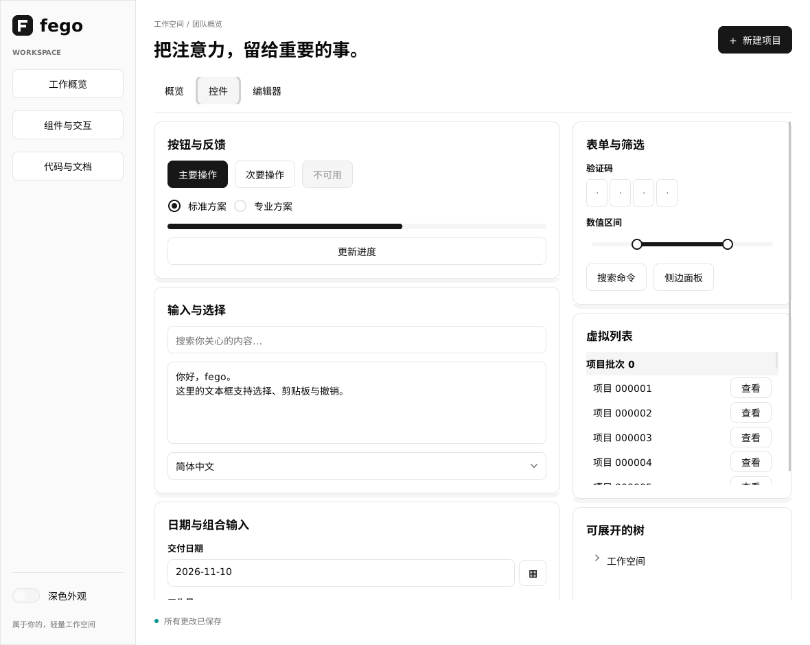
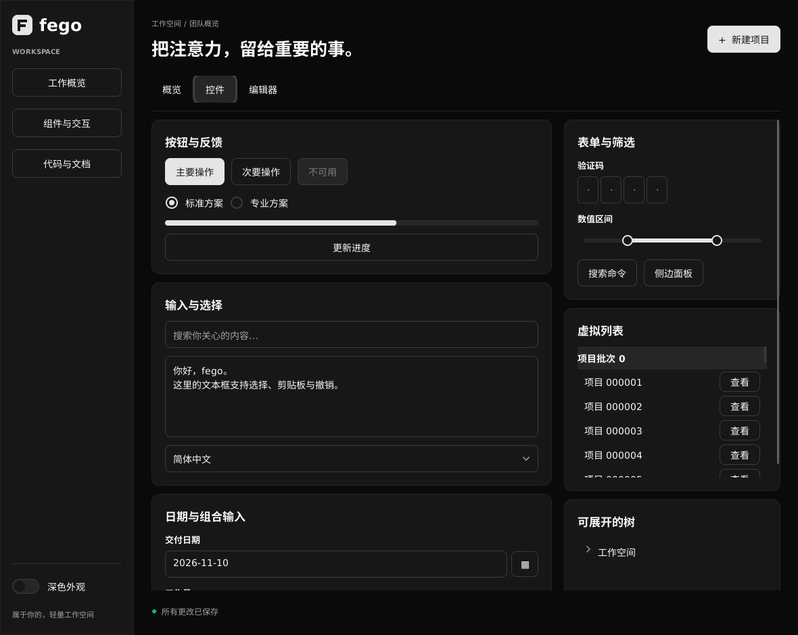

# fego

[English](README.md) | **简体中文**

轻量的 Go UI 工具包，支持原生桌面、移动端和浏览器。Linux、Windows、macOS 桌面构建使用纯 Go，Android 和 iOS 使用各自的原生 SDK。

通过 Go API 创建和更新控件，构建布局、表单、数据视图和文本编辑界面。默认浅色和深色主题使用 [shadcn Neutral 配色](https://ui.shadcn.com/docs/theming#default-theme-css)。

[示例](examples/gallery/main.go) · [性能数据](benchmarks/README.md) · [变更记录](CHANGELOG.md) · [CI](https://github.com/zatxm/fego/actions/workflows/ci.yml)

| 浅色控件 | 深色控件 |
| --- | --- |
|  |  |

## 平台支持

| 平台 | 窗口系统 | 架构 |
| --- | --- | --- |
| Linux | X11；Wayland 桌面通过 XWayland | amd64、arm64 |
| Windows | Win32 | amd64、arm64 |
| macOS | Cocoa | amd64、arm64 |
| Android | 原生 Activity | arm64、amd64 |
| iOS | UIKit | arm64 |
| 浏览器 | Canvas | WebAssembly |

Linux 运行时需要 X11 或 XWayland；本地服务器与 `libXext` 支持 MIT-SHM 时，窗口更新使用共享内存，否则回退为普通上传。中文显示需要系统中文字体，建议安装 Noto Sans CJK；Windows 和 macOS 使用系统字体。没有可用的系统拉丁字体时，会回退到内嵌 Go 字体。

## 快速开始

安装 Go 1.27.4 或更高版本。在空目录中创建项目并添加依赖：

```sh
go mod init example.com/hello-fego
go get github.com/zatxm/fego/v26
```

新建 `main.go`：

```go
package main

import (
	"log"
	"strconv"

	"github.com/zatxm/fego/v26"
	"github.com/zatxm/fego/v26/ui"
)

func main() {
	count := 0
	label := ui.Text("0").FontSize(40).Bold()
	button := ui.PrimaryButton("增加", func() {
		count++
		label.SetText(strconv.Itoa(count))
	})
	doc := ui.View(ui.Column(label, button).Center().Padding(24))
	if err := fego.Run(fego.WindowOptions{
		Title: "Hello fego", Width: 400, Height: 300, Content: doc,
	}); err != nil {
		log.Fatal(err)
	}
}
```

运行应用或构建可执行文件：

```sh
go run .
go build .
```

## 运行示例

克隆仓库后，可以运行包含表单、表格、弹窗、页面切换和主题切换的示例应用：

```sh
git clone https://github.com/zatxm/fego.git
cd fego
go run ./examples/gallery
```

通过参数选择深色主题或保存窗口截图：

```sh
go run ./examples/gallery -dark
go run ./examples/gallery -snapshot gallery.png
```

构建 Android 或 iOS 应用请参阅[移动端指南](docs/mobile.md)。

## 在浏览器运行

将同一套 Go 控件构建成 WebAssembly，再通过 HTTP 打开。

```sh
mkdir -p /tmp/fego-web
cp examples/web/index.html examples/web/main.js /tmp/fego-web/
cp "$(go env GOROOT)/lib/wasm/wasm_exec.js" /tmp/fego-web/
GOOS=js GOARCH=wasm go build -o /tmp/fego-web/app.wasm ./examples/studio
python3 -m http.server 8080 --directory /tmp/fego-web
```

打开 `http://localhost:8080`。窗口挂载到 ID 为 `fego` 的元素。为挂载元素设置高度并添加 `data-fego-fill`，窗口尺寸就会随容器调整。`wasm_exec.js` 需要来自构建应用时使用的 Go 工具链。用 `?dark` 切换深色主题。把 `sample.webm` 放在 `app.wasm` 旁后，可用 `?video=sample.webm` 打开视频标签页。

## 系统托盘与多窗口

在支持托盘的桌面会话运行 `go run ./examples/tray`。示例从托盘启动，可以通过菜单打开窗口。关闭窗口后应用仍在后台运行，从托盘选择 **Quit** 可退出。

在 `Run` 前设置 `AppOptions.ID`、`Name` 和 `Icon`。Linux 的 ID 要与应用启动项的 `StartupWMClass` 一致。Windows 安装包的快捷方式使用相同的 AppUserModelID。macOS 的应用包标识写在 Info.plist 中。文件管理器显示的应用图标由应用包和安装包提供。

用 `Window.Show`、`Hide` 和 `Activate` 控制指定窗口。用 `Window.OnClose` 拦截关闭请求。`AppOptions.KeepAlive` 允许应用在零窗口时继续运行，`app.Quit()` 退出整个应用。

在 UI 线程创建托盘、更新菜单。后台 goroutine 通过 `app.Post` 提交更新。Linux 会话需要支持 StatusNotifierItem 的托盘宿主，可通过 `Tray.Available()` 查询。单击和提示文字的呈现方式由桌面决定。macOS 菜单栏上绑定了菜单的图标单击后会打开系统菜单。

## 控件与功能

| 类别 | 接口 |
| --- | --- |
| 布局 | Box、Row、Column、Grid、Card、ScrollView、间距、padding、尺寸和对齐 |
| 基础控件 | Text、RichText、Button、PrimaryButton、Checkbox、Radio、Switch、Separator、Image |
| 表单 | TextInput、TextArea、密码、Field、Form、Select、ComboBox、Autocomplete、SearchField、MultiSelect、TokenField、InputGroup、InputOTP、NumberInput、Stepper、DecimalInput、TimeInput、ColorPicker、Slider、RangeSlider、Rating、Progress |
| 导航与反馈 | Tabs、Segmented、Accordion、Breadcrumbs、Sidebar、CommandPalette、Pagination、Menu、Dropdown、SplitButton、Dialog、Sheet、Drawer、Toast、Badge、Avatar |
| 数据 | List、VirtualList、Table（列排序）、Tree（展开与折叠）、LineChart、BarChart、AreaChart、StackedBarChart、PieChart |
| 日期与文档 | Calendar、DatePicker、CodeEditor、Editor、MarkdownEditor、Diff、Merge |
| 绘图和媒体 | Canvas、Painter、Path、EaseInOut、Spring、Keyframes、Timeline、Video、可选 GPU 呈现和 GLSL 着色器 |
| 输入 | 鼠标、滚轮、Tab 与方向键、Unicode、选择、剪贴板、撤销、系统输入法提交文本 |
| 无障碍 | Linux AT-SPI、Windows MSAA、macOS NSAccessibility、浏览器 ARIA |

右侧面板使用 `Sheet` 和 `Document.ShowSheet`。底部面板使用 `Drawer` 和 `Document.ShowDrawer`，可向下拖动关闭。

使用 `ui.PaginationWithTotal(page, pages, total, onChange)` 显示页码和总记录数。点击读数中的当前页，输入页码后按回车即可跳转。

## 更新状态与布局

创建控件树后，使用 `SetText`、`SetValue`、`SetSelected` 等方法更新已有控件。一个控件只能放入一个父节点或窗口；程序调用 setter 不会触发用户交互回调。

事件回调在 UI 线程执行。后台 goroutine 收到数据后，通过 `window.Update(func() { ... })` 或 `app.Post` 更新界面，避免从后台直接修改控件。`fego.Run` 应从 `main` 调用；使用 `NewApp` 管理窗口时，在运行前配置 `WhenReady`，并从该回调创建窗口。

布局尺寸使用逻辑像素。`FillWidth`、`FillHeight` 分别填满对应方向，`Grow` 按父容器的主轴分配剩余空间。`ScrollView` 用于展示超出可视区域的内容，键盘聚焦时会自动滚动到目标控件。

`Tabs`、`DatePicker`、`NumberInput`、`ComboBox` 和图表等复合控件通过 `.Element` 放入布局，并用 `.Element.Width(...)` 等方法设置尺寸；保留原对象，调用其专用方法更新值。`Badge`、`Avatar` 是静态装饰，更新内容时替换节点。

列表、表格和树只绘制可见行。修改列表行内容后调用 `Refresh`，行数变化时调用 `SetCount`；修改表格数据后调用 `SetRows`。这些控件会在适用时复用滚动区域，减少重绘工作。Linux 上由 X 服务器保留窗口像素，fego 只通过有上限的临时条带绘制受损区域，不在客户端保留整窗图像。

## 自定义行列表

纯文本、固定行高的列表使用 `ui.List`。需要图标、按钮、开关或不同行高时，使用 `ui.VirtualList`：

```go
list := ui.VirtualList(ui.VirtualListOptions{Count: len(items), Name: func(i int) string {
    return items[i].Name
}}, func(i int) *ui.Element {
    return ui.Row(ui.Text(items[i].Name).Grow(1), ui.Button("打开", func() { open(items[i]) }))
})
list.Fill()
```

虚拟列表只挂载可见行和少量相邻行。需要离开可视区域后保留的数据放在应用模型中。`Key` 让选择随数据重排，`Headers` 指定吸顶分组标题，`Reorder` 接收拖排结果。多选模式中 Shift 扩展选区，Ctrl 或 Command 切换单行。修改行数据后调用 `Refresh`。

## 文档、绘图和视频

用 `go run ./examples/studio` 体验编辑器、三方合并、动画绘图、图表和 GPU 开关。用 `go run ./examples/studio -video path/to/file.webm` 打开视频标签页。桌面端通过 PATH 中的 FFmpeg 读取本地文件并播放视频轨。浏览器端使用浏览器解码器，可播放音轨，媒体地址需要同源或允许跨域访问。在浏览器点击按钮等用户手势中调用 `Play`。视频播放支持桌面端和浏览器。

`ui.Editor` 提供查找替换、折叠范围和多光标，按住 Alt 点击可添加光标，点击行号旁的箭头可折叠或展开缩进块。`ui.MarkdownEditor` 提供预览。`ui.Diff` 并排显示差异。`ui.Merge` 自动合并独立修改，重叠修改可逐处选择保留哪一侧。`Text` 会返回结果并报告冲突是否都已解决。

在画布中使用 `ui.Path`，用 `FillPath` 填充或用 `StrokePath` 描边。图表使用 shadcn Neutral 配色，鼠标悬停或用方向键选中时会显示数值。`ui.Animate` 和 `ui.Timeline` 在 UI 线程更新，只在动画运行期间调度帧。

GPU 呈现默认关闭。创建窗口时可设置 `WindowOptions.GPU`，也可以在 UI 线程调用 `window.SetGPUEnabled(true)`。Linux、Windows 和 macOS 使用 OpenGL，浏览器使用 WebGL 2。用 `window.GPUActive()` 检查是否成功启用。硬件路径不可用时回退至 CPU 呈现。控件和路径由 Go 栅格化，可用 `window.SetFragmentShader` 通过 `frameTexture` 和 `frameUV` 应用整窗 GLSL 效果。移动端继续使用系统合成器。

## 文本与无障碍

中文、日文等文本依赖系统字体提供相应字形。文本编辑位置按 Unicode rune 计算，暂不支持完整的字素簇编辑、复杂文字 shaping、BiDi 或彩色 emoji。

密码字段不支持复制和剪切，无障碍接口只返回掩码。Linux 使用读屏功能时，应先开启系统无障碍服务再启动应用；应用运行后才开启读屏时，需要重启应用。

## 功能边界

- Linux 窗口使用 X11 或 XWayland，画布支持二维绘图。
- `CodeEditor` 提供文本编辑和行号，不包含 LSP 或富文本所见即所得编辑。
- Markdown 支持常用语法，尚未覆盖完整 CommonMark；HTML 按普通文本显示，链接通过回调通知应用，仅接受 http、https 和 mailto。

性能测量方法、场景和原始结果见 [性能数据](benchmarks/README.md)。
